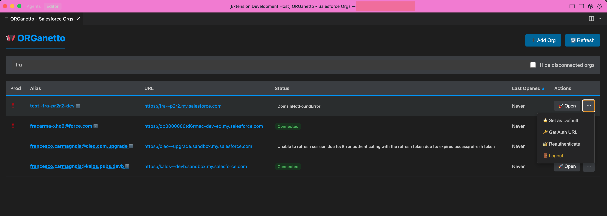

# 🪗 ORGanetto

A Visual Studio Code extension for managing your Salesforce orgs with style and efficiency. Perfect for developers juggling multiple Salesforce environments!

Click the 🪗 icon for instant access!

[Install from Visual Studio Marketplace](https://marketplace.visualstudio.com/items?itemName=fracarma.organetto)
[Install from Open VSX Registry](https://open-vsx.org/extension/fracarma/organetto)

## ✨ Features

### 🎯 Quick Org Management
- **View all your Salesforce orgs** in a clean, sortable table
- **Open orgs** directly in your browser with one click
- **Add new orgs** with a guided authentication flow
- **Set default org** for your workspace

### 🔐 Authentication & Security
- **Reauthenticate** disconnected orgs without losing data
- **Get Auth URL** - Copy SFDX Auth URL to clipboard for CI/CD or team sharing
- **Logout from orgs** with confirmation (removes them from your authenticated list)
- **Multi-org support** - Manage Production, Sandbox, Scratch, and Dev Hub orgs

### 🔍 Smart Filtering & Search
- **Text search** - Start typing anywhere to instantly search orgs by alias/username
- **Connection filter** - Toggle to show/hide disconnected orgs
- **Live filtering** - Results update as you type

### 📊 Sortable Columns
Click any column header to sort by:
- **Alias** - Alphabetically by org name
- **URL** - By instance URL
- **Status** - By connection status
- **Last Opened** - Most recently opened orgs first (default)

### 💾 Performance Optimized
- **Smart caching** - Org list is cached for instant loading
- **Manual refresh** - Click the refresh button to update from Salesforce CLI
- **Fast logout** - Removes orgs from the list without full refresh

### ℹ️ Detailed Org Info
Click on any org alias to view a popover with:
- Username
- Org ID
- Instance URL (clickable)
- Org Type (Dev Hub, Scratch Org, Sandbox, or Production)

### 🎨 Visual Indicators
- **⚡ Lightning bolt** - Scratch orgs
- **❗ Exclamation mark** - Production orgs (be careful!)
- **Status badges** - Quickly see connection status
- **Dropdown menus** - Access all actions with the ⋯ button

## 📋 Requirements

- **Salesforce CLI v2.105.0 or higher** - [Install or Update](https://developer.salesforce.com/tools/salesforcecli)
- **VS Code v1.99.0 or higher**

## 🚀 Usage

### Opening ORGanetto
1. Open a Salesforce project in VS Code
2. Click the **🪗** icon in the status bar, OR
3. Open Command Palette (`Cmd+Shift+P` / `Ctrl+Shift+P`)
4. Run **"ORGanetto: Show my Salesforce Orgs"**

### Adding a New Org
1. Open Command Palette (`Cmd+Shift+P` / `Ctrl+Shift+P`)
2. Run **"ORGanetto: Add Salesforce Org"**, OR
3. Click the **"+ Add New Org"** button in the ORGanetto tab
4. Follow the guided setup:
   - Select org type (Org or DevHub)
   - Choose instance (Production, Sandbox, or Custom)
   - Enter an alias
   - Authenticate in your browser

### Quick Actions
- **🚀 Open** - Opens the org in your default browser
- **⋯ More Actions** (dropdown):
  - **⭐ Set as Default** - Set this org as your workspace default
  - **🔑 Get Auth URL** - Copy SFDX Auth URL to clipboard
  - **🔐 Reauthenticate** - Reconnect a disconnected org
  - **🚪 Logout** - Remove org from authenticated list

### Keyboard Tips
- **Start typing** - Search box auto-focuses for quick filtering
- **Click column headers** - Sort by that column
- **Click aliases** - View detailed org information in a popover

## 💡 Tips & Tricks

- **Recently used first** - The list defaults to "Last Opened" sort, so your frequently used orgs are always at the top
- **Quick find** - Use the search box to instantly filter large org lists
- **Clean view** - Check "Hide disconnected orgs" to focus on active connections
- **Share access** - Use "Get Auth URL" to securely share org access with team members or CI/CD pipelines
- **Production safety** - Look for the ❗ icon to identify production orgs at a glance
- **Scratch org tracking** - The ⚡ icon helps you quickly identify scratch orgs

## 🔧 Extension Settings

This extension works out of the box! No configuration needed - just install and start managing your orgs.

## ⚠️ Known Issues

None currently! If you encounter any issues, please [report them on GitHub](https://github.com/fracarma/organetto/issues).

---

## 🎵 About

**ORGanetto** is named after the organetto, a small accordion instrument. Just like an organetto brings harmony to music, this extension helps you orchestrate your Salesforce orgs with efficiency and style.

Built with ❤️ for Salesforce admins and developers who appreciate good tooling.

**Enjoy!** 🪗
